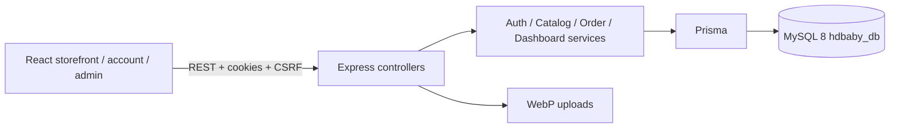
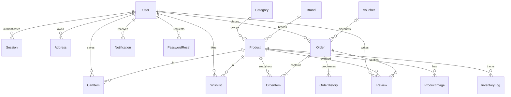
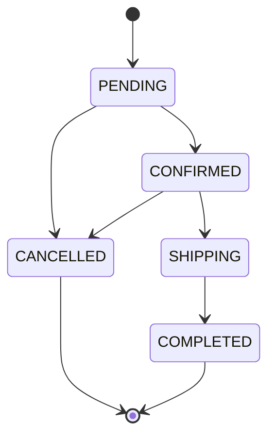

# Kiến trúc HDbaby

Presentation Layer: React 19 + Vite, TypeScript strict, React Router, Tailwind và component tùy chỉnh; TanStack Query quản lý dữ liệu server; Axios xử lý cookie, CSRF và refresh; React Hook Form/Zod cho auth và checkout. Các route lớn được lazy-load. Font Be Vietnam Pro và ảnh WebP được phục vụ local. Motion tôn trọng prefers-reduced-motion; Recharts sử dụng số liệu API thật.

Business Layer: Express 5 routes/controllers → services/orders.ts cho giá, voucher, transaction kho và trạng thái; dashboard.ts tổng hợp dữ liệu MySQL. Auth service băm/so sánh bcrypt, ký JWT và phát phiên cookie. Admin resource registry cung cấp CRUD với schema riêng, không cho client tự chọn tên bảng hoặc cột.

Data Layer: Prisma 6.19.3 + MySQL 8 InnoDB. Có migration SQL, FK, unique constraints và index. Tiền VND lưu Decimal(12,0), JSON serialize thành string. Không có SQLite, JSON database hoặc mock API thay thế.

Các bảng độc lập phục vụ CMS: banners, articles, faqs, settings; thông điệp: contacts, newsletters.

## Đặt và hủy đơn

1. Validate cấu trúc request, loại trùng productId, lấy userId từ session.
2. Dùng idempotency key unique gắn user, hash payload để phát hiện dùng lại key với nội dung khác.
3. Trong transaction Serializable: đọc sản phẩm đang bán, giá, danh mục/thương hiệu còn hiển thị, tồn kho và các điều kiện voucher.
4. Kiểm tra expectedTotal nếu có. Trừ kho bằng UPDATE có điều kiện stock >= quantity, ghi InventoryLog.
5. Tăng lượt voucher, ghi Order/OrderItem snapshot và OrderHistory, xóa đúng sản phẩm đặt khỏi giỏ.
6. Nếu xung đột P2034, thử lại transaction tối đa 4 lần. Nếu cùng idempotency key đã được commit, trả lại đơn cũ, không trừ kho thêm.
7. Hủy chỉ từ PENDING/CONFIRMED: cập nhật có điều kiện trạng thái cũ và hoàn kho trong cùng transaction. CANCELLED không thể hủy lần nữa.

## Phiên và bảo vệ dữ liệu

- JWT access 15 phút chứa sid; mỗi request xác minh phiên MySQL chưa hết hạn và tài khoản đang hoạt động.
- Refresh token ngẫu nhiên, chỉ lưu SHA-256 ở MySQL, hiệu lực 7 ngày. Refresh xoay token và thu hồi phiên cũ.
- Cookie HttpOnly, SameSite=Lax; Secure khi production. CSRF dùng token trong cookie HttpOnly kết hợp header lấy qua API cùng origin. Origin của mutation được kiểm tra.
- Backend kiểm tra role cho mọi route Admin; scope userId cho giỏ, địa chỉ, wishlist, đơn, thông báo và review.
- Bcrypt cost 12, password reset hash + expiry + single use, đổi mật khẩu thu hồi mọi session.
- Helmet, CORS allowlist, giới hạn body, rate limit; log có cấu trúc không ghi body/cookie/token/password; không trả stack trace.
- Upload kiểm tra MIME lẫn nội dung, kích thước và số pixel; Sharp re-encode thành WebP với tên UUID. Không chấp nhận SVG từ người dùng.
- Review chỉ tạo khi đơn thuộc tài khoản, đã COMPLETED và chứa sản phẩm; sửa review gửi duyệt lại; trung bình sao chỉ tính review hiển thị.

Transaction strategy tham khảo [Prisma transactions](https://www.prisma.io/docs/orm/prisma-client/queries/transactions); thiết lập Express tham khảo [Express security best practices](https://expressjs.com/en/advanced/best-practice-security/). Cấu hình đã triển khai và các test trong repository là nguồn xác minh hành vi thực tế.
